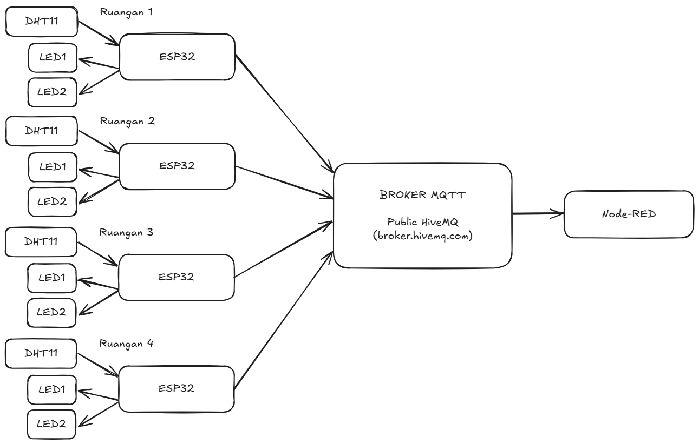
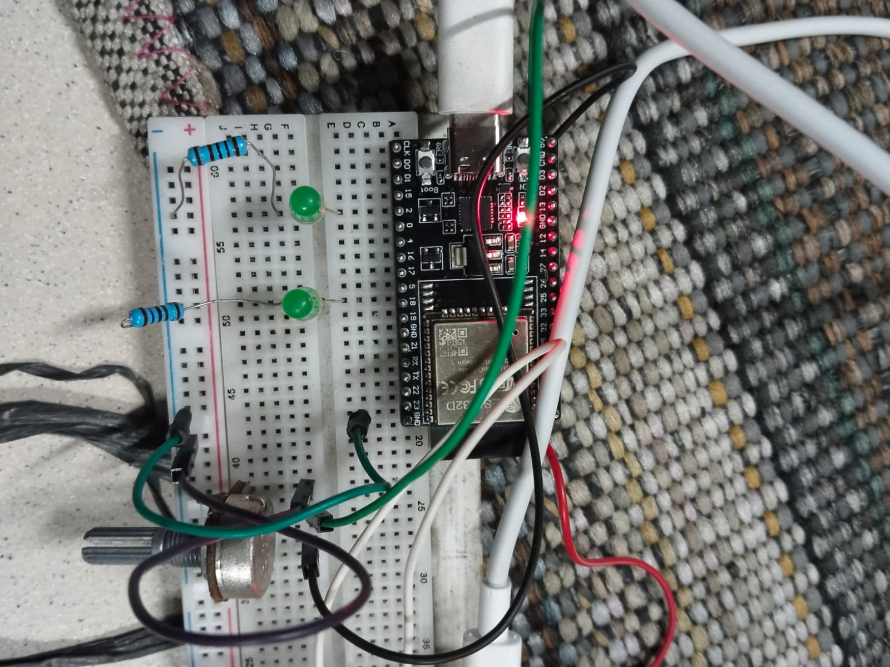
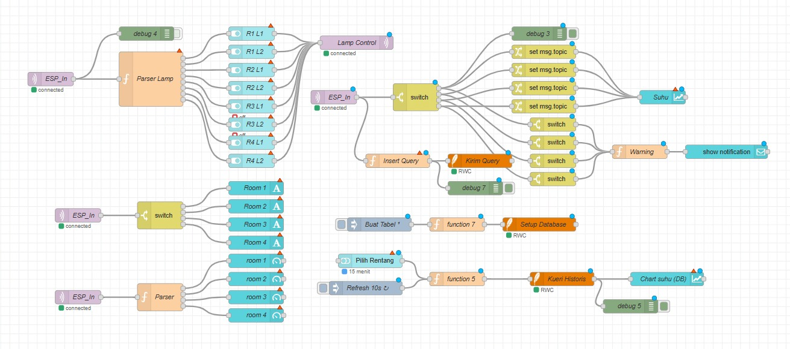
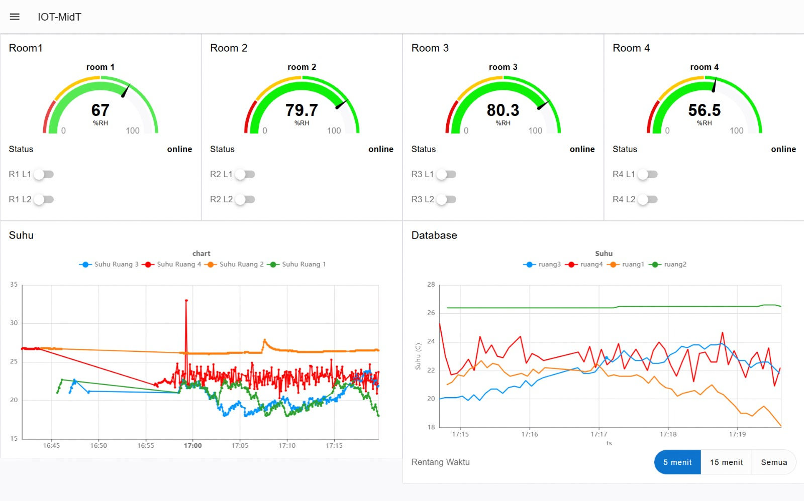

# Monitoring dan Kontrol 4 Ruangan dengan ESP32, MQTT, dan Node-RED

Sistem IoT untuk memantau suhu dan kelembapan (DHT11) serta mengendalikan 2 lampu di setiap ruangan (`ruang1` s.d. `ruang4`). Setiap ruangan memakai satu ESP32 yang berkomunikasi lewat satu broker MQTT. Node-RED bertindak sebagai client yang menampilkan data di dashboard (chart, gauge, status online/offline) dan mengirim perintah nyala/mati lampu.

> Tugas Evaluasi Mata Kuliah Jaringan Sensor dan IoT, Kelompok **X**.

## Video

| Video | Link |
| --- | --- |
| Video presentasi (maks. 7 menit) | _ada_ |
| Video demo alat (maks. 5 menit) | [linkdemo.md](https://drive.google.com/file/d/1ePUYD1adyhX2TjJKfQdkXCwF1kgWJQSa/view?usp=sharing) |

## Anggota Kelompok

| Nama | NRP | Ruangan |
| --- | --- | --- |
| _Yovan Giofrey_ | _2124600096_ | ruang1 |
| _Ahmad Faza Fauzan_ | _2124600101_ | ruang2 |
| _Adrian Indra Pratama_ | _2124600110_ | ruang3 |
| _Shafa Revalina_ | _2124600112_ | ruang4 |

## Arsitektur Sistem




Alur singkat:

- ESP32 mempublikasikan suhu dan kelembapan setiap 5 detik, serta status `online`/`offline` (retain, dengan Last Will).
- Node-RED berlangganan topic dengan wildcard `+` dan menampilkannya di dashboard.
- Saklar dashboard mengirim `1`/`0` ke topic lampu ruangan yang dituju. ESP32 hanya subscribe topic ruangannya sendiri.

## Perangkat Keras

**Komponen per ruangan:** 1x ESP32, 1x sensor DHT11, 2x LED, 2x resistor 220 Ω, kabel jumper.

| Komponen | Pin ESP32 | Catatan |
| --- | --- | --- |
| DHT11 VCC | 3.3V | |
| DHT11 GND | GND | |
| DHT11 DATA | GPIO16 | _ubah jika memakai pin lain_ |
| LED lampu 1 + resistor 220 Ω | GPIO25 | Anoda ke pin, katoda ke GND lewat resistor |
| LED lampu 2 + resistor 220 Ω | GPIO26 | Sama seperti lampu 1 |

Foto rangkaian satu ruangan:



## Broker dan Topic

**Broker:** `broker.mqttdashboard.com:1883` (HiveMQ publik) _(ganti jika memakai Mosquitto lokal)_

Semua topic diawali prefix kelompok `pens/klpX/` (ganti `klpX` dengan nomor kelompok, mis. `klp3`).

| Topic | Arah | Payload | QoS | Retain |
| --- | --- | --- | --- | --- |
| `pens/klp1/ruangN/temperature` | ESP32 → Node-RED | °C, 1 desimal (mis. `28.5`) | 0 | tidak |
| `pens/klp1/ruangN/humidity` | ESP32 → Node-RED | %, 1 desimal (mis. `65.0`) | 0 | tidak |
| `pens/klp1/ruangN/lamp1` | Node-RED → ESP32 | `1` nyala, `0` mati | 1 | tidak |
| `pens/klp1/ruangN/lamp2` | Node-RED → ESP32 | `1` nyala, `0` mati | 1 | tidak |
| `pens/klp1/ruangN/status` | ESP32 / LWT | `online` atau `offline` | 0 | ya |

Wildcard yang dipakai di Node-RED: `pens/klpX/+/temperature`, `pens/klpX/+/humidity`, `pens/klpX/+/status`.

## Cara Menjalankan

### 1. ESP32

1. Pasang library Arduino lewat *Sketch → Include Library → Manage Libraries*:
   - `EspMQTTClient` (Patrick Lapointe)
   - `DHT sensor library` (Adafruit), beserta `Adafruit Unified Sensor` bila diminta
2. Buka `esp32/esp32_ruang/esp32_ruang.ino`.
3. Sesuaikan konstanta berikut:
   - `KELOMPOK` dengan nomor kelompok
   - `ROOM` (`ruang1` s.d. `ruang4`), **hanya ini yang berbeda antar board**
   - `WIFI_SSID` dan `WIFI_PASS` (jangan commit data asli, lihat catatan di bawah)
4. Upload ke masing-masing ESP32, lalu buka Serial Monitor (115200). Pesan `MQTT Connection established.` menandakan koneksi berhasil.

> **Catatan keamanan:** kode di repositori memakai `SSID_LAB` / `PASSWORD_LAB` sebagai placeholder. Ganti dengan data Wi-Fi sendiri saat upload, atau simpan di `secrets.h` (sudah masuk `.gitignore`, contohnya di `secrets.example.h`).

### 2. Node-RED

1. Pasang Node-RED, lalu pasang paket `node-red-dashboard` lewat *Menu → Manage palette → Install*.
2. Import flow: *Menu → Import → pilih `node-red/flows.json`*.
3. Pada node `mqtt-broker`, pastikan server dan port sama dengan di kode ESP32, lalu klik **Deploy**.
4. Buka dashboard di `http://localhost:1880/ui` (dari HP: `http://<IP_laptop>:1880/ui`).

## Screenshot

Flow Node-RED:



Dashboard:



## Hasil Pengujian

_Isi dengan hasil pengujian kelompok sendiri (✓ / ✗) dan keterangan singkat._

| No | Uji | Hasil | Keterangan |
| --- | --- | --- | --- |
| T1 | Koneksi ESP32 ke broker | ✓ | Berhasil terhubung ke broker MQTT secara stabil tanpa kendala konektifitas. |
| T2 | Data 4 ruangan masuk tiap ±5 detik | ✓ | Aliran data dari keempat ruangan masuk. |
| T3 | Chart suhu menampilkan 4 garis | ✓ | Grafik berhasil merender keempat garis suhu ruangan secara bersamaan. |
| T4 | Sensor berubah hanya di ruangan yang disentuh | ✓ | hanya nilai pada ruangan terkait yang berubah dengan sempurna. |
| T5 | Lampu tepat sasaran | ✓ | Perintah berhasil mengontrol aktuator lampu yang dituju. |
| T6 | Matikan lampu | ✓ | Fungsi untuk mematikan lampu merespon perintah dengan baik. |
| T7 | Payload salah diabaikan | ✓ | Sistem berhasil memfilter dan mengabaikan format payload yang tidak valid tanpa error. |
| T8 | Status online | ✓ |  |
| T9 | LWT: status offline saat daya dicabut | ✓ | |
| T10 | Retained: status langsung tampil setelah restart Node-RED | ✓ | |
| T11 | Reconnect otomatis | ✓ | |
| T12 | Akses dashboard dari HP | ✓ | |

## Ruangan yang Disimulasikan

_Tulis ruangan mana yang disimulasikan (minimal 2 ruangan harus ESP32 sungguhan). Jika semua ESP32 sungguhan, tulis "Tidak ada"._

## Kendala dan Solusi

| Kendala | Solusi |
| --- | --- |
| _Kekurangan ESP32_ | _Meminjam Teman Kelompok Lain_ |
| _kekurangan DHT11_| _Meminjam Teman kelompok Lain_ |

## Pembagian Tugas

| Anggota | Tugas |
| --- | --- |
| _Yovan Giofrey_ | _Membuat Flow Node-RED_ |
| _Ahmad Faza Fauzan_ | _Memprogram ESP_ |
| _Adrian Indra Pratama_ | _Membuat Rangkaian_ |
| _Shafa Revalina_ | _Dokumentator_ |

## Struktur Repositori

```
KelX-TugasNodeRED-ESP32/
├── README.md
├── esp32/
│   └── esp32_ruang/
│       └── esp32_ruang.ino
├── node-red/
│   └── flows.json
├── docs/
│   ├── laporan.pdf
│   └── images/
└── video/
    └── LINK.md
```
